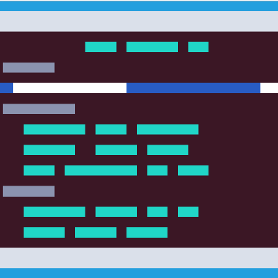

### Hi there 👋

I'm Antony, an open-source enthusiast and the creator of [netboot.xyz](https://netboot.xyz). I enjoy 
hacking on hardware, software, and helping others learn about technology. 

#### 👷 Check out what I'm currently working on

- [netbootxyz/netboot.xyz](https://github.com/netbootxyz/netboot.xyz) - Your favorite operating systems in one place.  A network-based bootable operating system installer based on iPXE. (4 days ago)
- [netbootxyz/docker-builder](https://github.com/netbootxyz/docker-builder) - Docker container for optimizing netboot.xyz builds (5 days ago)
- [netbootxyz/pciids](https://github.com/netbootxyz/pciids) - pciids for iPXE usage (6 days ago)
- [netbootxyz/docker-netbootxyz](https://github.com/netbootxyz/docker-netbootxyz) - netboot.xyz docker container (1 week ago)
- [netbootxyz/ubuntu-spins](https://github.com/netbootxyz/ubuntu-spins) - Ubuntu Spins - mini-iso expanded (1 month ago)

#### 🌱 My latest projects

- [antonym/bootc-rocky](https://github.com/antonym/bootc-rocky) - bootc build for Rocky Linux
- [antonym/openstack-canary](https://github.com/antonym/openstack-canary) - openstack-canary
- [antonym/playground](https://github.com/antonym/playground)
- [antonym/utility-load](https://github.com/antonym/utility-load)
- [antonym/autobench](https://github.com/antonym/autobench)

#### 🔨 Latest Pull Requests I published

- [lspci: stop when pciids.ipxe fails signature verification](https://github.com/netbootxyz/netboot.xyz/pull/1853) on [netbootxyz/netboot.xyz](https://github.com/netbootxyz/netboot.xyz) (3 days ago)
- [ubuntu: keep pinned kernels bootable when Ubuntu moves the ISO](https://github.com/netbootxyz/netboot.xyz/pull/1852) on [netbootxyz/netboot.xyz](https://github.com/netbootxyz/netboot.xyz) (3 days ago)
- [Restrict GITHUB_TOKEN to read-only in pull-requests workflow](https://github.com/netbootxyz/netboot.xyz/pull/1841) on [netbootxyz/netboot.xyz](https://github.com/netbootxyz/netboot.xyz) (1 month ago)
- [Add Ubuntu 26.10, refresh point releases, remove dead code](https://github.com/netbootxyz/ubuntu-spins/pull/32) on [netbootxyz/ubuntu-spins](https://github.com/netbootxyz/ubuntu-spins) (1 month ago)
- [Show ShredOS version matching the detected architecture](https://github.com/netbootxyz/netboot.xyz/pull/1832) on [netbootxyz/netboot.xyz](https://github.com/netbootxyz/netboot.xyz) (2 months ago)

#### ⭐ Recent stars

- [milind-soni/OpenMausBot](https://github.com/milind-soni/OpenMausBot) - Open-source Grok Bot alternative with a virtual machine that bots can use (2 weeks ago)
- [getopenscreen/openscreen](https://github.com/getopenscreen/openscreen) - Record your screen, ship a demo. Free and open-source, GPU-accelerated, no watermarks, no subscriptions. Windows, macOS, Linux. Actively maintained. (3 weeks ago)
- [rorkai/App-Store-Connect-CLI](https://github.com/rorkai/App-Store-Connect-CLI) - Fast, scriptable CLI for the App Store Connect API. Automate TestFlight, builds, submissions, signing, analytics, screenshots, subscriptions, and more (4 weeks ago)
- [morluto/rea](https://github.com/morluto/rea) - Reverse engineer anything with agents, from app behavior down to native binaries. (1 month ago)
- [pirxpilot/liftie](https://github.com/pirxpilot/liftie) - :ski: Clean, simple, easy to read, fast ski resort lift status. (3 months ago)

#### 📜 My recent blog posts

- [Introducing Phosphor: A Music Visualizer for macOS](https://littleknife.dev/blog/2026/04/29/introducing-phosphor/) (7 months ago)
- [A Proven Dual-Mac Dock Setup with One-Button Switching](https://littleknife.dev/blog/2026/04/28/dual-mac-docking-station-setup/) (7 months ago)
- [Infrastructure Knowledge, Packaged for AI Agents](https://littleknife.dev/blog/2026/04/02/your-ai-agent-can-write-react-but-cant-deploy-kubernetes/) (8 months ago)
- [Bootable Containers with bootc-rocky](https://littleknife.dev/blog/2026/03/26/bootable-containers-with-bootc-rocky/) (8 months ago)
- [PXE Booting on the Steam Deck](https://littleknife.dev/blog/2022/08/02/pxe-booting-on-the-steam-deck/) (4 years ago)

#### 💬 Feedback

If you use one of my projects, I'd love to hear from you! Don't be shy and let me know what you liked
and what needs being improved. Got an issue? Open a ticket, I don't bite and will try my best to help!

#### 📫 How to reach me

- X: https://x.com/ntonym
- Blog: https://littleknife.dev
- IRC: antonym on Libera
